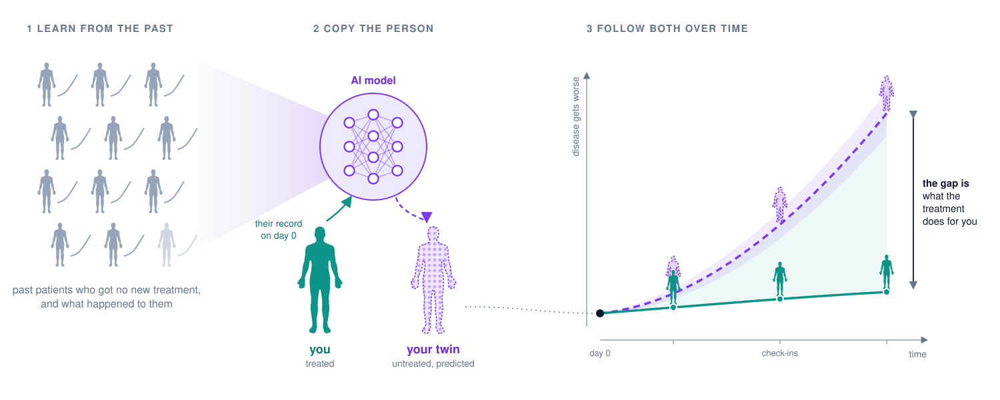

**The TLDR:**

- **What?** In medicine, a digital twin is a model that predicts what would happen to *you* if nothing changed. No 3D avatar, no simulated organ. Just a forecast with your name on it.
- **So what?** In a clinical trial, that forecast is the thing control groups exist to give us: what happens without the treatment. If a model can give it reliably, fewer people need to be on control groups, and we can see per person whether a treatment is working.
- **Now what?** It only earns that role after it survives external datasets and a shadow-mode run on a live trial. That's what I'm working on right now.

## You've probably heard the word

"Digital twin" got very popular very fast. A digital twin of the heart, of the immune system, of a whole patient, a whole hospital, a whole city. I've read papers promising a full simulation of your biology, molecule by molecule, and I'll just say it: most of that is hype, at least for now.

So is it even a thing? Honestly, yes. Just a lot less cinematic than the slides make it look.

Before writing this post, I wanted to find where the term started: it comes from engineering! NASA, and aircraft makers, kept a model of each physical machine, updated with that machine's own sensor data, so they could ask "what happens to *this* engine if we keep flying it like this?" without breaking the engine. Nobody needed the 3D rendering for that. What they needed was the counterfactual (what happens under a scenario you can't, or don't want to, test for real).

If you treat the human body as the most complex engineered system ever built and apply that use case to medicine, you arrive at a single definition:

> A digital twin is a model's prediction of what would happen to a specific person under a specific scenario (treatment, no treatment, disease, etc.).

## The problem: every trial needs people who don't get the treatment

Say you have a new vaccine or a new drug and you want to know if it works. You can't just give it to 100 people and see how they do, because you don't know how they would have done anyway. Some would have recovered on their own. Some would have gotten worse no matter what.

So trials split people into two groups:

- the **treatment** group, who get the new thing;
- the **control** group, who get a placebo, the current standard treatment, or nothing.

Compare the two, and the difference is your answer.

It works, but it's expensive, and also half the volunteers, sometimes sick people hoping for something new, end up in the group that doesn't get it. Recruiting them takes months. And you only find out whether the treatment works at the end.

## The opportunity: controls leave a trail

Control groups aren't new. Every trial of the last few decades had one, and every hospital has its standard-care patients. These people have records: age, blood tests, scans, history and, most importantly, **what happened to them** without the new treatment.

Which is data. Which means you can train a model on it.

So the question becomes: can we train a model on all those past controls that takes a new person's record at the start of a trial and predicts what would happen to them *without* the treatment?

The figure is the whole idea in three steps. (1) Learn the untreated course from people who came before. (2) A new participant joins; their day-0 record goes into the locked model, and out comes their twin. (3) Follow both at every check-in.

## Enter: the twin

Now pretend, just for a second, that the model is perfect.

A new participant joins the trial and gets the treatment. On day one we give the model their record, and it tells us what this person will look like at month 3, month 6, month 12 *if they had not been treated*.

That prediction is their digital twin. Same person, same starting point, same biology, minus the treatment. We save it.

Then the trial runs. At every real check-in (a blood draw, a scan), we put the real measurement next to the twin's:

- **The gap opens** (the real person is doing clearly better than their twin): the treatment is doing something in this person, and we can see how much and how fast.
- **Real ≈ twin** (the real person is tracking their untreated self): the treatment isn't doing much for them. We can switch or stop early instead of finding out a year later.

You get two things out of this. The first is the one everyone talks about: **fewer controls**. If the twin is good, you need fewer real people on control, because the model fills in part of the "what if nothing" side. The second is the one I find more exciting: **a comparison inside the same person**. Treated you vs untreated you, at every time point. A regular trial tells you the treatment works on average. This lets you watch it working, or not, in each participant, and act on it. That saves time and money and, in some diseases, lives.

To be fair, none of this is revolutionary. Using models of past controls to strengthen a trial is already accepted in some places: European regulators qualified one such approach (PROCOVA) for certain trials back in 2022. The idea is solid. The hard part is doing it carefully enough that people can trust it for *their* disease.

## Of course, the model is wrong sometimes

Your AI model will miss, by some amount, and that amount is everything.

So in practice the twin is an estimate with error bars: "given this person's biology, here is the likely untreated course, and here is how sure we are." That's the shaded band in the figure. On its own it would be risky to lean on. As an extra piece of information next to the real controls, a per-person risk read-out, it already beats what a standard trial gives you at the individual level, which is nothing.

The caveats are the usual AI ones, plus what biology adds on top:

- **Your model is as good as your data.** Size and quality both. A twin trained on 50 patients from one hospital will not generalise to 500 patients from five.
- **Everyone's biology is unique.** Two people with the same record can still go two different ways, and some of that is noise no model will ever capture.
- **Things drift.** Standard care improves, populations shift, tests change. Last decade's controls may not look like this year's.

I've hit the data problem myself. Getting the right records for a specific trial, with the right follow-up, is often the slowest part of the whole project, way slower than the modelling. Still, I'm optimistic. Records, lab results, sequencing, wearables: medicine is going digital fast, and the data to build good twins is coming. The open question is mostly robustness now.

## How I'd make it trustworthy

This is what I care about most. It's a medical setting, and "it scored well on my test set" doesn't cut it. Here's the ladder I'd propose, and roughly what we're building:

1. **Train on the history of similar trials.** Past controls from trials as close as possible to the one you want to run: same disease, same standard care, same kind of patients. Test on held-out patients the model never saw, and on later years, so you know it holds up over time and not just on a random split.
2. **Validate on outside datasets.** Other hospitals, other trials. Cross-validate across trials and stratify by trial, so the model has to work on a dataset it wasn't built on. The statisticians I work with call the resulting setup a **hybrid external-control design**: you still enrol some real concurrent controls, and the model (built on external and historical data) adds to them rather than replacing them outright.
3. **Run it in shadow mode.** The final exam. During the actual trial, the model predicts every new control participant on day one, the prediction is locked, and nobody uses it for any decision. Months later, you compare what it predicted to what really happened. Only if it passes do you start leaning on it, for example to need fewer new controls.

Shadow mode is the step I'd never skip. Training, testing, and external validation all run on data that existed before the trial. Shadow mode is the first time the model faces the exact population, sites, and conditions it will be used on, with no way to peek. Regulators seem to be heading the same way: the FDA's recent guidance on AI in drug development asks for a credibility assessment tied to the exact use of the model, and a locked, versioned, documented model is the natural way to give them that.

## What I'm working on

I can't share specifics yet (it's part of a grant application in progress), but I've been designing the modelling side of a multi-institution trial project with academic and industry partners. The model is real: a model trained on past controls that predicts each participant's untreated outcome, with the validation ladder above. 

If it holds up, we get fewer people needed for the control groups, faster answers, and a chance to stop a treatment that isn't working before it costs a year. If it doesn't, the trial runs as normal and we learned something. 

If you're working on twins, external controls, or trial design and want to compare notes, I'd genuinely love to hear from you.
