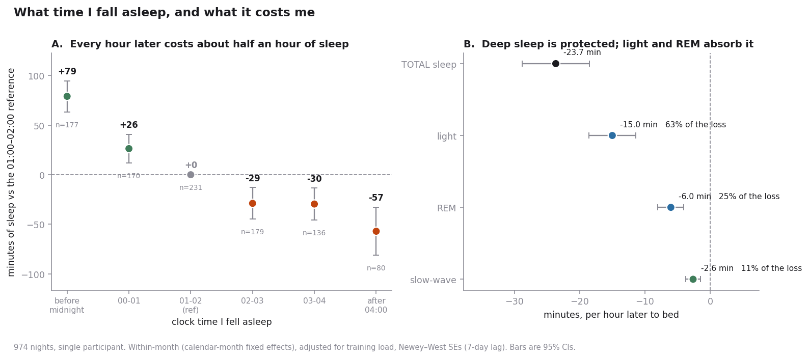

## Overview

For three years I ran a deliberate, badly-controlled optimization experiment on myself: stopped stimulants, added supplements, rebuilt my gym routine, worked on sleep and wore a Whoop continuously throughout to measure whether any of it worked.

This is the analysis of that record: **1007 consecutive days** (Aug 2023 – Aug 2026), treated as a measurement problem rather than a health story.

The short answer to "which of my optimisations worked": the largest effect in three years of data was a variable I had never modelled, and the most interesting intermediate result turned out to be an artifact of a hardware upgrade.

- Built a reproducible pipeline from a raw multi-file export to a one-row-per-day analysis table (one row that contains daily metrics values), and found two silent bugs that had been corrupting every result
- Identified the **largest single driver of my sleep duration**, and it was a variable the device records automatically and never asks about
- Reverse-engineered the **rolling-baseline behaviour** of the vendor's recovery score, produced a fitted model that predicted a three-year trend from daily variation
- Developed an **empirical-null placebo calibration** for detecting structural breaks in autocorrelated self-tracked series
- Full estimation stack: **Newey–West (HAC) standard errors**, **month fixed effects**, **Benjamini–Hochberg FDR**

The most useful output is the negative one. A result that survives every within-sample diagnostic can still be an artifact of the instrument, and this project is a worked example of catching that.

---

## The Data

The raw export is four files at different grains:

| File | Rows | Grain |
|---|---|---|
| `physiological_cycles.csv` | 1,009 | one physiological cycle |
| `sleeps.csv` | 1,110 | one sleep, naps separated |
| `workouts.csv` | 1,038 | one logged activity |
| `journal_entries.csv` | 12,206 | one question per day |

These merge into **1,007 daily rows covering 94% of the calendar days** in the span. Outcomes are HRV, resting heart rate, recovery score, respiratory rate, blood oxygen, skin temperature, and the full sleep-stage breakdown.

---

## Data Preparation, and Two Bugs That Mattered

This section is most of the actual work, and it is where the project nearly died without anyone noticing.

### A "day" does not start at midnight

A physiological cycle begins at **sleep onset**, not at 00:00. I verified this directly against the export: `Cycle start time` equals `Sleep onset` exactly on every row that has both. A cycle runs from falling asleep to falling asleep again, and its recovery score describes the day you wake *into*.

That has a consequence most people will hit and not see:

- I am a late sleeper: 827 of 1,009 cycles begin between midnight and 5am, where cycle-start date and the day described are the same
- But **171 cycles begin between 21:00 and 23:59**, and every one collides on the calendar with the cycle that legitimately owns that date
- My first pipeline keyed on cycle-start date and called `drop_duplicates(keep="first")`

That silently deleted **115 cycles, 113 of them early-bedtime nights**, and they were not a random 11%:

| | kept | silently dropped |
|---|---|---|
| mean recovery | 58.9 | **66.3** |
| mean sleep | 386 min | **454 min** |

It was discarding my best-rested, longest-sleep nights, in a way correlated with the exposures I was studying. **The fix:** join on the cycle-start *timestamp*, which is cycle identity rather than a date and matches exactly across all four files, then label each row by the calendar date of **wake onset**. Two collisions instead of 115. **113 days recovered.**

No error was raised at any point. It is one line doing exactly what it was told.

### Missing journal answers are two different things

Journal questions were rolled out in batches, so a question has **no rows at all** before its launch date. Separately, the prompt goes unanswered on ~22% of cycles.

Neither is filled with `False`. A day before a question existed is not a verified "no", and neither is a skipped prompt. Both stay `NaN` so every model's `dropna()` removes them. An earlier version filled them with `False` instead, which turns a comparison of *eras* into what looks like a comparison of *behaviours*.

---

## Statistical Approach

Three problems are structural in this kind of data. Each has one fix.

1. **Autocorrelation.** Today's HRV is highly predictable from yesterday's, so ordinary regression thinks it has ~900 independent facts when it has far fewer, and returns error bars that are too narrow. → **Newey–West (HAC) standard errors**, one-week lag window. Point estimates unchanged; uncertainty made honest.

2. **Slow confounding.** Behaviour is not randomly assigned across a life: habits, training and stress move in multi-month blocks, so any pooled contrast is partly "2025 vs 2026". → **Month fixed effects**, which force every comparison to happen *within* a calendar month and absorb anything moving slower than that. Months containing only exposed or only unexposed days are dropped, since they carry no within-month contrast.

3. **Multiple comparisons.** The project runs well over a hundred tests, which buys about five free discoveries at p < 0.05. → **Benjamini–Hochberg FDR**, reported as q within each family.

Every model is fit **twice**, naive and within-month, and both are reported. *The gap between them is itself a result*: it measures how much of an apparent effect was era.

Deliberately not used: no PCA, no mixed models, no machine learning. Every question here is "does this exposure shift this one outcome," with one subject and n in the hundreds. OLS with the right standard errors and the right fixed effects answers that exactly; anything heavier would add opacity without adding identification.

---

## What the Models Showed

### Sleep timing dominates everything else

The variable I had never modelled turned out to be the largest one available.

- **Compensation:** for each hour later I fall asleep, I wake only **0.40 hours later** (95% CI 0.24–0.56). I recover 40% of a late night and lose the rest
- **Net cost:** roughly **24 minutes of sleep per hour of delay** (95% CI −28.8 to −18.5, n = 974)
- **Relative scale:** bedtime alone explains **15.1%** of the variance in sleep duration; month fixed effects  season, fitness, life phase, hardware explain **4.9%**
- **Dose-response:** monotone across six bedtime bins spanning 136 minutes end to end
- **Composition:** light sleep absorbs 63% of the loss, REM 25%, slow-wave only 11%

That last point is a validity check rather than a finding, and it is the one I like most. Deep sleep being defended while light sleep is cut is the textbook homeostatic hierarchy under sleep restriction: reproduced here by a wrist device inferring stages from photoplethysmography and an accelerometer. It does not make the staging accurate in absolute terms. It does say the errors are not large enough to wash out real structure.

**Two nulls worth reporting:** rolling 7-day variability in sleep onset adds nothing once the level is known (p = 0.39 / 0.79 / 0.93 for duration, recovery, HRV). And there is no rebound: a short night is not repaid the next night (p = 0.32).

### Illness is detectable early and still useless as an alarm

Converting each biomarker to a personal rolling 30-day z-score, with the window shifted so today is never inside its own baseline, and counting only the **first day** of each episode (28 onsets from 108 flagged days):

- HRV sits at **z = −0.63 three days before onset** against +0.04 on control days, q = 0.005
- A composite index over the pre-onset window gives **Cohen's d = 0.37, p = 0.004**

The signal is real. The product is not: a threshold catching **57% of illnesses** costs about **76 false alarms a year**, one every five days. Tighten it to one false alarm a month and you catch one illness in seven.

A statistically significant biomarker and a usable clinical alert are completely different bars. That gap is why a company can publish a true early-detection result and still not ship the feature.

---

## The Result That Didn't Survive

The headline finding of an earlier version of this project was that the vendor's recovery score, computed against a rolling personal baseline, has a **negative long-run sensitivity to HRV**: responding to sustained change backwards. A fitted transfer function located a 30-day baseline window and predicted the observed multi-year drift quantitatively (+2.3 pts/yr predicted, +1.68 observed).

**It does not survive a device-generation split.**

| Fit | n | Long-run sensitivity (pts/ms) | 95% CI |
|---|---|---|---|
| Pooled | 967 | −0.281 | −0.426 to −0.136 |
| Older hardware | 704 | −0.273 | −0.523 to −0.022 |
| **Newer hardware** | 256 | **+0.686** | +0.269 to +1.104 |
| 2024 alone | 298 | +0.048 | −0.547 to +0.643 |

The sign flips, and the newer-hardware interval excludes both zero and the pooled estimate. The descriptive paradox behind it was never significant either (between-quarter r = −0.29, p = 0.34, 13 quarters); at monthly resolution the correlation is **positive inside both eras** and null when pooled.

The mechanism is a single offset: the newer device reads mean HRV 69.0 ms against 91.4, while giving a *higher* mean recovery score.

Two offset clouds, one regression line, and a slope that describes neither of them.

### The method that catches it

The transferable piece is the calibration, not the failure.

- Take the discontinuity estimator and run it at **400 randomly chosen cut-dates** across the record
- That gives the distribution of jumps this specific autocorrelated series produces where nothing happened
- Score the real date against it

On resting heart rate at the device swap, a naive t-test gives p < 0.0001; the empirical null says a jump that big appears in **18% of random splits**. Three orders of magnitude of overconfidence, all from autocorrelation. On HRV at the same date, the observed step is smaller than random splits produce 66% of the time: nothing at all.

A method that ranks a real artifact far from a non-artifact, rather than confirming everything, is the useful kind.

Supporting this: across a documented sequence of personal changes preceding the hardware swap, my resting heart rate is flat (53.3 → 52.4 → 54.2 → 54.6 bpm, no step significant) and then jumps **+4.7 bpm** at the device change alone.

Months of deliberate change, no movement; one afternoon with a different strap, four and a half beats.

---

## Limitations

Stated plainly, because they are the reason this is a portfolio project and not a paper.

- **n = 1.** Nothing here generalises to people. It generalises, at most, to *method*.
- **Sleep duration is partly an accounting identity** with bedtime and wake time. The empirical content is the 40% compensation coefficient, not the 24 minutes, which partly follows from it.
- **The device timestamps sleep onset, not lights-out.** A night spent awake in bed is indistinguishable from a night that simply started late, and this dataset can never separate them. An earlier version of this analysis claimed a falsification test had ruled that out; the test was inverted, since high sleep pressure predicts exactly the consolidation pattern I had treated as evidence against it.
- **Everything is observational.** Bedtime is chosen, not assigned. The next step is a pre-registered, block-randomised, placebo-blinded crossover on a single lever, the only design here that could settle a cause.
- **Effect sizes are not stable across device generations**, which is the whole point of the section above.

---

## What It Actually Concluded

Ranked by effect size, across three years of things I deliberately changed and one thing I never thought to measure:

| Lever | Effect on nightly sleep |
|---|---|
| **Bedtime, 25th → 75th percentile** | **−57 min** |
| Moving apartment | +47 min |
| Screens in bed | −25.7 min |
| Melatonin | confounded by indication: I take it on nights I expect to sleep badly |
| Morning light, meditation | no comparison group; compliance too high to estimate anything |

**This is n = 1 and it does not generalise.** It is not health advice and I would be annoyed at anyone reading it as such. What it supports is a claim about *method*: that a single subject with enough observations and careful enough estimation can identify which of their own levers matter. It is not a claim about people.

But it is my n of 1, and for a decision about my own life that is often the more relevant number. The ordering above says I had my priorities backwards: I spent three years adding and removing things, measuring carefully, while the largest available lever sat underneath all of it, unmeasured.

My sister is a psychiatrist and has been giving me this advice for free for years: **first things first. Before you add stuff, take stuff away, or buy supplements, work on your sleep.** It took a thousand nights of data, one false positive, and a lot of Newey–West standard errors to reproduce what she said over dinner.

---

## Where I'd like to take this next

- **Log lights-out time.** One button press a night, and it resolves the largest open limitation.
- **Run the randomised crossover.** Pre-registered, ~102 nights per arm from this dataset's own residual variance, roughly seven months.
- **Treat the current hardware era as day zero of a clean series**: one instrument, no structural break, still growing.

If you work on digital biomarkers, wearable signal validity, or n-of-1 methodology, or you build these devices and want an outside read on how the longitudinal record behaves, my contact details are at the bottom of this page.

*Raw data stays on my machine. Numbers reported here are summaries, not rows.*
